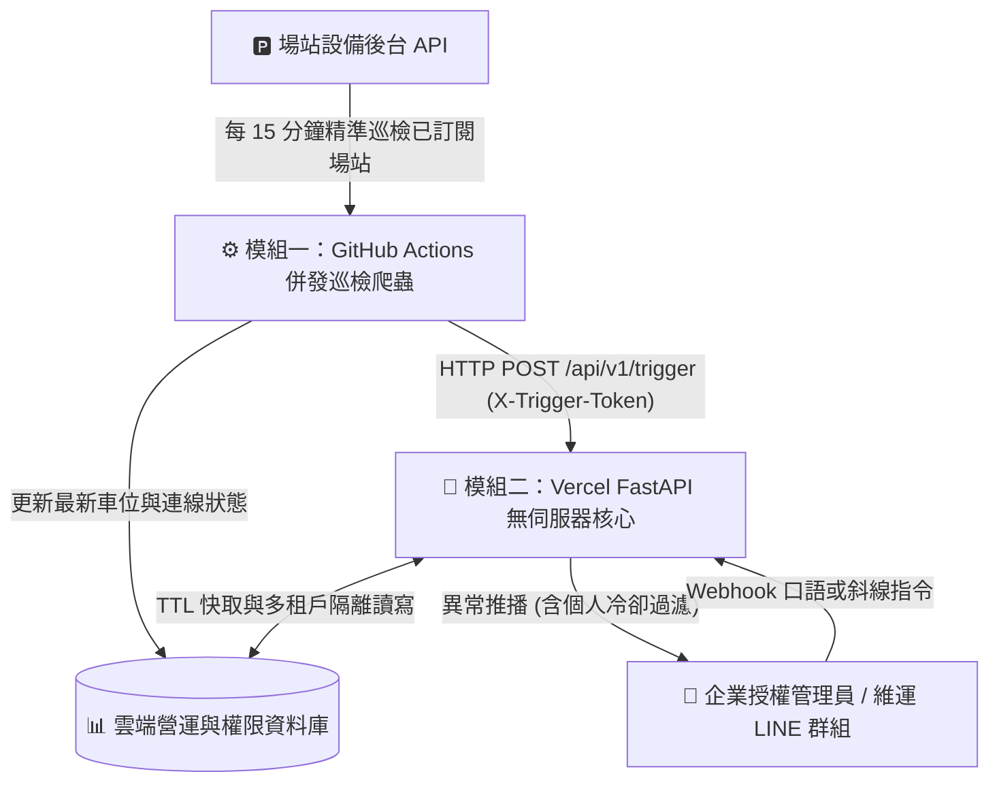

# 場域訊息通報｜多租戶智慧停車場異常監控系統 (LINE Bot)

[](version.py)
[](.env.example)
[](.github/workflows/crawler_schedule.yml)
[](https://line-tenant-notify.vercel.app/)

> ### ⚠️ 前言｜使用前必讀準備事項
> **使用前請務必提供欲監控的場站相關資訊，待系統管理者完成後台建檔與設定之後，將會產生專屬的「企業授權碼」供您輸入綁定。**
>
> - 📖 **線上互動式操作手冊網頁**：[https://line-tenant-notify.vercel.app/](https://line-tenant-notify.vercel.app/)
> - ➕ **加入 LINE 場站監控中心（`@586cwcxm`）**：[https://line.me/R/ti/p/@586cwcxm](https://line.me/R/ti/p/@586cwcxm)

---

## 系統簡介

本專案採「**資料巡檢與權限推播分離**」的雲端無伺服器微服務架構，結合 **GitHub Actions（每 15 分鐘併發訂閱場站巡檢）** 與 **Vercel Serverless Function（企業授權碼綁定、個人／群組自主選站、雙軌自然語言理解、多租戶隔離推播）**，協助各停車場營運企業即時掌握「**剩餘車位上下限異常**」與「**場站設備斷線**」警報。

---

## 核心功能特色 (`v1.6.0`)

1. **企業授權碼驗證與多租戶物理隔離**：
   - 初次加入 LINE 官方帳號或拉入群組時，必須驗證管理者核發之**企業授權碼**（範例格式：`sample_auth_888`）。
   - 各企業僅能瀏覽、訂閱與接收隸屬該企業授權範圍內之合法場站，跨租戶資料嚴格隔離。
2. **自主挑選監控場站（配額上限 10 座）與視覺化卡片操作**：
   - 輸入 `/可選場站` 自動展開該企業授權候選場站清單（編列 `[01]`～`[99]` 代號），可直接點擊場站右側 **「➕ 可新增 / ➖ 可移除」** 按鈕即時切換。
   - 支援「**防呆二次確認清空**」：輸入「`解除全部的場站監控`」或 `/移除 全部` 時，會先彈出二次確認卡片保護自訂門檻，確認後一次清空選站並安全保留企業綁定身分。
3. **方案 B 雙軌自然語言引擎（Track 1 本機極速 `< 1ms` ＋ Track 2 Gemini AI 備援）**：
   - **第 1 軌（零金鑰本機語意引擎）**：支援單句多場站萃取、複合動作（新增同時設定門檻）、局部單邊門檻更新，並內建常見新注音同音字容錯（如 `廠 -> 場`、`下線 -> 下限`、`上線 -> 上限`）。
     - *「幫我把前金成功場跟青埔二場列入監控」*
     - *「幫我把台中東山列入監控，車位少於 8 格通知我」*
     - *「設定樹林俊興廠的車位門檻下線為5上限為15」*
     - *「把樹林俊興場的車位上限改為 20」*（原下限自動保留）
     - *「樹林俊興場車位通知冷卻改成 12 小時」*
   - **第 2 軌（Google Gemini Interactions API 選配）**：當環境變數設定 `GEMINI_API_KEY` 時，針對複雜長句自動啟用結構化 JSON 解析（`store=False` 不留存外部對話紀錄）。
4. **LINE 群組「智慧靜默閘門（Smart Silent Gate）」與多群組獨立隔離**：
   - **日常聊天 100% 靜默不插嘴**：在 LINE 群組中，同事間日常對話、問號 `?` 或無關閒聊時，機器人完全保持安靜。
   - **精準回應管理意圖**：僅在偵測到新增／移除場站、調整車位門檻或冷卻時數、查詢清單、教學手冊或企業授權碼綁定時才現身回覆。
   - **多群組獨立綁定**：以 LINE `group_id` 獨立綁定，同一人將機器人邀請至多個群組並啟用不同企業授權碼亦完全隔離不衝突。
5. **免費額度防超支保護鎖（195 / 200 瀕危警告 ＋ 超級管理者靜音開關）**：
   - 群組被動回覆（`reply_token`）消耗 `0` 則；主動異常推播自動依個人（`+1`）或群組實際成員人數（`+N`）精準累加月度計數，並於每月自動歸零（台灣標準時間 `UTC+8`）。
   - 當月累積達 `195` 則時，自動向超級管理者推送「🚨 瀕危警告卡片」與「🔕 一鍵全系統靜音（`/靜音`）」按鈕。

---

## 系統架構圖



---

## 專案目錄結構

```text
line_tenant_notify/
├── .agents/skills/line-bot-nlu/  # 自然語言與 LINE Flex 規格專屬參考規範
├── .github/workflows/
│   └── crawler_schedule.yml      # 模組一：GitHub Actions 每 15 分鐘自動巡檢排程
├── api/
│   └── index.py                  # 模組二：Vercel FastAPI 進入點、Webhook 與線上教學頁路由
├── crawler/
│   ├── crawler.py                # 模式 A 精準訂閱場站併發巡檢爬蟲
│   └── run_crawler.sh            # Linux flock 防重疊執行腳本
├── docs/
│   └── index.html                # 線上互動式操作手冊網頁 (支援 Vercel 首頁與 GitHub Pages)
├── services/
│   ├── line_service.py           # LINE Messaging API 與 Flex Message 視覺化卡片建置
│   ├── nlp_service.py            # 雙軌自然語言理解引擎 (Track 1 極速規則 + Track 2 Gemini)
│   ├── sheets_service.py         # Google Sheets 串接、TTL 防限流快取與斷線容錯
│   └── tenant_service.py         # 多租戶權限隔離、群組靜默閘門、個人門檻與冷卻判定
├── tests/
│   └── test_super_admin_and_warning.py # 完整單元與整合測試套件
├── vercel.json                   # Vercel 路由配置
├── requirements.txt              # Python 相依套件清單
├── version.py                    # 系統版本號單一真實來源 (v1.6.0)
└── .env.example                  # ISO27001 環境變數設定範本 (不含真實機敏值)
```

---

## 環境變數說明（ISO27001 資安遵循）

所有憑證、金鑰與資料表識別碼皆**嚴禁寫死於程式碼**，請透過 GitHub Actions Secrets 與 Vercel Environment Variables 注入（詳見 [`.env.example`](.env.example)）：

| 環境變數名稱 | 必要性 | 用途說明 |
| :--- | :---: | :--- |
| `GOOGLE_SERVICE_ACCOUNT_BASE64` | 必填 | GCP 服務帳號憑證 JSON 之 Base64 編碼字串 |
| `MASTER_SPREADSHEET_ID` | 必填 | 場站與企業名單主檔試算表 ID（唯讀權限 `<YOUR_MASTER_SPREADSHEET_ID>`） |
| `GOOGLE_SPREADSHEET_ID` | 必填 | 多租戶權限、個人監控與冷卻紀錄試算表 ID（`<YOUR_OPERATIONS_SPREADSHEET_ID>`） |
| `LINE_CHANNEL_SECRET` | 必填 | LINE Messaging API Channel Secret |
| `LINE_CHANNEL_ACCESS_TOKEN` | 必填 | LINE Messaging API Channel Access Token |
| `NOTIFY_TRIGGER_SECRET` | 必填 | 模組一爬蟲喚醒模組二 `/api/v1/trigger` 之專用驗證密鑰 |
| `VERCEL_NOTIFY_URL` | 爬蟲端必填 | Vercel 觸發端點網址（例：`https://<your-domain>.vercel.app/api/v1/trigger`） |
| `GEMINI_API_KEY` | 選填 | 啟用第 2 軌 Google Gemini 語意備援時填寫（未填時以第 1 軌 `< 1ms` 引擎全功能運作） |
